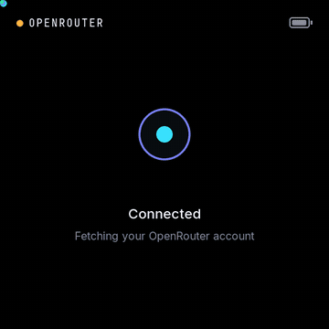
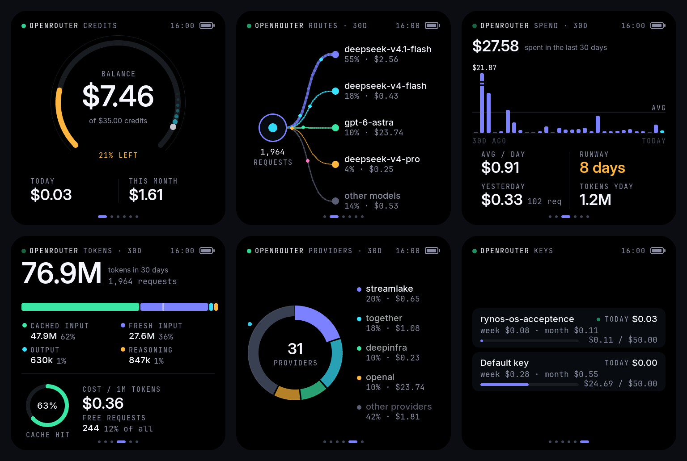

<p align="center">
  
</p>

<h1 align="center">OpenRouter Meter</h1>

<p align="center">
  A live desk display for your <a href="https://openrouter.ai">OpenRouter</a> account —
  balance, spend, where your requests are routed, tokens, providers and keys —
  on a 2.16″ AMOLED touch screen, updated every 20 seconds.
</p>

<p align="center">
  <a href="SETUP.md"><b>Set it up (plain-English guide)</b></a> ·
  <a href="#screens">Screens</a> ·
  <a href="#how-it-works">How it works</a> ·
  <a href="docs/development.md">Build from source</a> ·
  <a href="#license">License</a>
</p>

---

## What you get

- **Six animated screens** that answer the questions you actually have: *How much
  credit is left? What did I spend today? Which models and providers am I using?
  How long will my balance last?*
- **Correct numbers.** Everything comes from OpenRouter's own API and is summed
  exactly, to the cent (see [Where the numbers come from](#where-the-numbers-come-from)).
- **Alerts** — the meter wakes up, flashes its edges and shows a banner when your
  balance drops below a threshold or today's spend passes your daily budget.
- **Zero-fuss setup.** One small Windows app (no Python, no installer wizard).
  It installs itself, starts with Windows and **pairs with the meter by itself**.
- **Safe by design.** It only needs a read-only *management* key, which can't
  spend credits. The key never leaves your PC; the Bluetooth link is encrypted
  and the meter refuses new PCs unless you physically allow pairing.

## Screens

Tap the screen (or press **BOOT**) to move to the next screen, **KEY** to go back.

<p align="center"></p>

| Screen | What it shows |
|---|---|
| **Credits** | Balance with a gauge of how much of your purchased credit is left, spend today and this month. A packet "comet" sweeps the ring; when you spend, the balance counts down and the amount floats up. |
| **Routes** | Your traffic being routed: your account hub sends packets to your top models. Line weight and packet rate follow each model's real share of 30-day requests. |
| **Spend** | Daily spend for 30 days. A one-off spike is drawn with an axis break so normal days stay readable. Average per day, **runway** (days your balance lasts at that rate), and yesterday's spend, requests and tokens. |
| **Tokens** | 30-day token volume split into cached input, fresh input, output and reasoning; cache-hit rate; your effective cost per million tokens; free-model requests. |
| **Providers** | Which providers actually served your requests, as a ring that spotlights each one in turn. |
| **Keys** | Spend today / this week / this month for each API key, with a bar for keys that have a spending limit. |

Choose which screens appear in the app's settings.

## What you need

| | |
|---|---|
| Display | **Waveshare ESP32-C6-Touch-AMOLED-2.16** (480×480 AMOLED, touch, battery connector) |
| PC | Windows 10 or 11 with Bluetooth |
| Account | An OpenRouter account and a **management key** (free to create) |
| Cable | A USB-C cable that carries data (for the one-time firmware install) |

→ **[Follow the setup guide](SETUP.md)** — about 10 minutes, no programming.

## How it works

```
 OpenRouter API ──HTTPS──▶  OpenRouter Meter app (Windows tray)  ──Bluetooth LE──▶  the meter
 /credits /activity /keys     polls every 20 s, builds small        (encrypted,          draws the screens
 (read-only management key)   messages, sends only what changed     bonded link)         with LVGL
```

- **The app** (`app/`, Rust) runs in the system tray. It polls three free,
  read-only OpenRouter endpoints, turns them into compact JSON messages and
  writes them to the meter. Its tray icon shows the link status and your
  balance at a glance.
- **The meter** (`firmware/`, C++ / LVGL 9 on the ESP32-C6) renders the screens
  and animations, handles touch and buttons, alerts, dimming and auto-rotation.
- **The protocol** is documented in [docs/protocol.md](docs/protocol.md).

## Where the numbers come from

| On screen | Source |
|---|---|
| Balance, credits | `/credits`: total purchased − total used |
| Spend today | The **largest** of: the sum of every key's `usage_daily` (OpenRouter-computed, live) and the rise in your lifetime usage since the app first saw today. Each can only under-count, so the larger is the better estimate. |
| This month | The larger of: sum of keys' `usage_monthly` (live), or completed days this month from `/activity` + spend today |
| 30-day history, models, providers, tokens | `/activity` (completed UTC days), summed in exact dollars and rounded once |
| Keys | `/keys` |

Days follow **UTC**, like OpenRouter. OpenRouter only publishes request and
token counts for *completed* days, so those screens show the last 30 days and
"yesterday" rather than live counts for today — the meter never shows a number
it can't get right.

## Buttons

| | |
|---|---|
| Tap screen / **BOOT** | Next screen |
| **KEY** | Previous screen |
| **PWR** short press | Brightness (4 levels) |
| **PWR** hold 3 s, then release | Forget this PC and pair a new one |
| **PWR** hold 8 s | Power off (short press to turn on) |

## Repository layout

```
app/        Windows tray app (Rust) — OpenRouter polling, Bluetooth, settings
firmware/   ESP32-C6 firmware (C++, PlatformIO, LVGL 9) + desktop simulator
docs/       Protocol, development, flashing and hardware notes; web flasher
```

## Privacy

The app talks only to `openrouter.ai` (your account data) and to your meter.
No analytics, no telemetry, no cloud service of ours. Your key is stored in
`%APPDATA%\OpenRouterMeter\settings.txt` on your PC and is never written to the
log or sent to the meter.

## License

**[PolyForm Noncommercial 1.0.0](LICENSE)** — free to use, modify and share for
personal, hobby, educational and other noncommercial purposes. **Selling it, or
using it for commercial purposes, is not permitted** without the author's
permission. Third-party components keep their own licenses — see
[THIRD_PARTY_NOTICES.md](THIRD_PARTY_NOTICES.md).

OpenRouter is a trademark of its owner. This is an independent project and is
not affiliated with, endorsed by or sponsored by OpenRouter.
